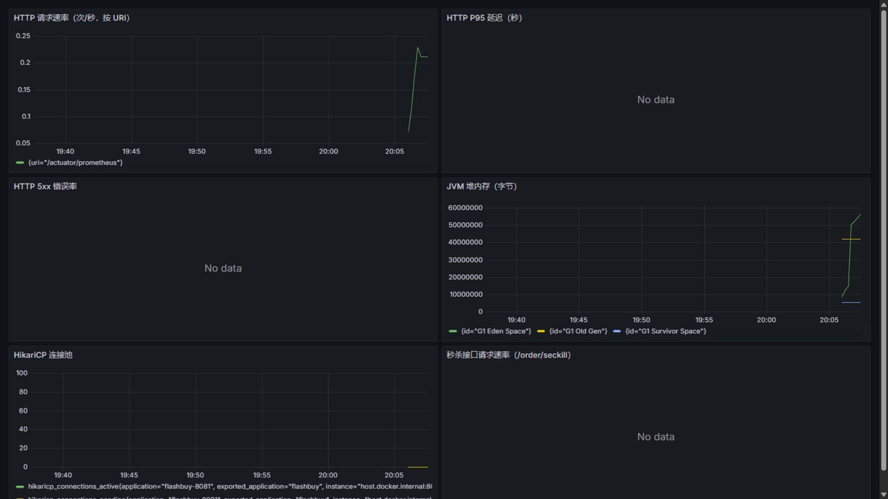

# 闪购 FlashBuy ⚡
[](https://github.com/zhaojin0614/flashbuy/actions/workflows/ci.yml)

> 潮玩 / 演出票限量抢购平台 —— 一个以「限量抢购」为核心业务的高并发实战项目。
> 源自对黑马点评课程的系统性学习，并在其之上完成了技术栈升级、架构重构与品牌重塑。

## 核心亮点

### ⚡ 秒杀 / 抢购链路（重点）

```
请求线程              Redis                      RocketMQ                    消费者容器
   │                   │                            │                          │
   ├── seckill.lua 原子脚本 ──► 资格判断+预扣库存+写资格Set                        │
   │                   │                            │                          │
   ├── 同步发送 MQ ─────┼──────────────────────────► │ seckill_order_topic       │
   │  （发送失败→补偿 Lua 原子回滚资格与库存）                        │           │
   ├── 立即返回订单号    │                            └──push──► SeckillOrderListener
   │                                                │  Redisson 分布式锁（一人一单）
   │                                                │  proxy.createOrder() @Transactional
   │                                                │  数据库乐观锁扣库存（防超卖兜底）
   │                                                ├── 正常返回 = CONSUME_SUCCESS
   │                                                └── 异常自动重试 → 死信 %DLQ%
   │                                                    落库成功 → 延迟消息(15m) → OrderCloseListener
   │                                                    状态机 CAS 1→4 + 回补库存/撤销资格
```

- 一人一单三道防线：Lua 的 Set 判断 → Redisson 锁 → 数据库 count 校验
- 事务保障：锁包住整个事务调用，`proxy.createOrder` 返回即事务已提交后才释放锁
- 消息可靠性：事务消息（半消息 → Lua 预扣 → COMMIT/回查）+ 消费自动重试 + 死信 + 幂等三层
- 压测对比（同机双组）：消费吞吐翻倍（125→250 单/s）、DB 与入口洪峰解耦，详见 [docs/seckill-loadtest.md](docs/seckill-loadtest.md)

### 🧊 缓存体系
- 缓存穿透（空值缓存）、击穿（逻辑过期 + 互斥锁）、雪崩（随机 TTL）
- 通用 `CacheClient`：函数式编程封装任意实体缓存逻辑
- 缓存一致性：先更新数据库再删除缓存

### 🔐 分布式锁演进
SETNX 简易锁 → 线程标识防误删 → Lua 保证释放原子性 → **Redisson 看门狗**

### 🏘 其他功能
GEO 附近商户 · BitMap 签到与连续统计 · HyperLogLog UV 统计 ·
推模式 Feed 流（滚动分页）· 点赞 SortedSet 与排行榜 · Redis 全局唯一 ID

## 技术栈（2026 基线）

| 层 | 技术 |
|---|---|
| 语言 / 运行时 | JDK 21 |
| 框架 | Spring Boot 3.5.16 |
| ORM | MyBatis-Plus 3.5.18.1 |
| 缓存 / MQ | Redis 7（Lettuce）、Redisson 3.50、RocketMQ 5.3（Docker）消息队列 |
| 数据库 | MySQL 8.0 |
| 前端 | 原生 JS + 手写 CSS（无框架依赖），nginx 8080 反代 |
| 版本控制 | Git（每次改造独立提交，可追溯） |

## 快速启动

```bash
# 1. 数据库：执行 src/main/resources/db/flashbuy.sql
mysql -uroot -p -e "CREATE DATABASE IF NOT EXISTS flashbuy DEFAULT CHARACTER SET utf8mb4;"
mysql -uroot -p flashbuy < src/main/resources/db/flashbuy.sql

# 2. Redis：localhost:6379（application.yaml 可改）

# 3. RocketMQ（秒杀异步下单）：docker compose 一键拉起 NameServer + Broker
docker compose -f docker/rocketmq/docker-compose.yml up -d

# 4. 可选：创建本地密钥配置（application-local.yaml 已被 .gitignore 忽略）
#    填入本机 MySQL 密码与 JWT 密钥；不创建则使用 application.yaml 的本地默认值
cp application-local.example.yaml application-local.yaml

# 5. 启动后端（8081）
mvn spring-boot:run

# 6. 启动前端（8080，/api 反代 8081）
cd nginx-1.18.0 && ./nginx.exe

# 7. 浏览器打开 http://localhost:8080
#    登录验证码输出在应用控制台日志（演示环境）
```

### 多实例部署（可选，P6 分布式实证）

```bash
# 两个实例 + nginx 轮询分摊（Redis/RocketMQ 本就共享，业务代码零改动）
java -jar target/flashbuy-*.jar --server.port=8081
java -jar target/flashbuy-*.jar --server.port=8082
# nginx.conf：取消 upstream 中 8082 行的注释（只跑单实例时保持注释，避免死节点重试）
cd nginx-1.18.0 && ./nginx.exe -s reload
```

响应头 `X-Upstream` 标识实际服务的节点；MQ 集群消费（CLUSTERING）自动在两实例间
分摊消息，一人一单/限流/幂等依赖共享 Redis 与 DB，跨实例天然生效。
分布式验证结论：同一用户并发双发（分别命中两实例）恰好落一单，生产与消费在
两实例间对称分摊——见《闪购改造记录》第 42 章。

### 监控（P5）

```bash
docker compose -f docker/monitoring/docker-compose.yml up -d
# Grafana 面板已自动装配（Prometheus 数据源 + FlashBuy 看板）：http://localhost:3000（admin/admin）
```

覆盖 HTTP 请求速率/P95 延迟/5xx 错误率、JVM 内存、HikariCP 连接池、秒杀接口速率；
Prometheus 抓取 8081（可选 8082 第二实例）的 `/actuator/prometheus` 端点。



## 接口概览

| 模块 | 路径 | 说明 |
|---|---|---|
| 用户 | `/user/code` `/user/login` `/user/me` `/user/sign` | 验证码、登录、当前用户、BitMap 签到 |
| 商户 | `/merchant/{id}` `/merchant/of/type` `/merchant/of/name` | 详情、分类检索、名称检索 |
| 商品 | `/product/list/{merchantId}` `/product/seckill` | 商品列表、上架限量商品 |
| 抢购 | `POST /order/seckill/{productId}` | Lua 原子预扣 + 异步落库 |
| 晒单 | `/post/hot` `/post/{id}` `/post/like/{id}` | 热门晒单、点赞 |

## 改造记录（关键里程碑）

- `ce53e04` Spring Boot 2.7 → 3.5.16 / JDK 21 / MyBatis-Plus 3.5.18（含 MP 3.5.9+ 拆包迁移）
- `d029137` 选题改名：包名 / 表名 / 类名 / 接口路径全部语义化，数据库重构为 flashbuy
- `88c4a0e` 全新前端 + Lua 消息字段名修复 + 端到端验证
- `a46fe24` 秒杀落库事务修复：锁外移 + 代理调用 + pending 补偿
- `0b3a3e3` JWT 双 Token / 黑名单 / 滑动窗口限流 / 月累计签到
- `4fa551a` 晒单闭环：评论、发布、我的订单
- `fa5e2af` 商户发现、详情与相关晒单（GEO 附近 + 排序）
- `47aef93` 个人资料、关注动态与粉丝列表
- `7f468e0` 包名升级 `com.zhaojin.flashbuy` 并清除原作者标识
- `c577a8b` 敏感配置支持环境变量覆盖
- `9529ded` 缓存深化：Caffeine 两级缓存 + Pub/Sub 跨实例失效 + 压测报告（c494e28/841abac/9529ded）
- `3f7a6d4` PEL 滞留消息补丁 + RocketMQ 4.9 Docker 环境（3f7a6d4/7e34de4）

完整逐条原理记录（含验证数据与面试问法）见飞书《闪购改造记录（边改造边学习）》。

## Roadmap

- [x] P1 认证与安全：JWT 双 Token + 登录限流（Redis + Lua 滑动窗口）
- [x] P2 缓存深化：Caffeine + Redis 两级缓存、Pub/Sub 失效、延迟双删、压测报告
- [ ] P3 秒杀增强：RocketMQ 替代 Redis Stream、事务消息 / 本地消息表、压测报告
- [ ] P4 搜索：Elasticsearch 全文检索 + 数据同步
- [ ] P5 可观测：Prometheus + Grafana 监控、CI 流水线
